

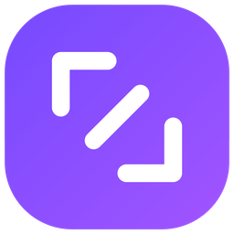

# Pixel Grabber

**Screenshot, annotation, screen recording, color picking and floating reference tools for graphic designers, by DesignByKazbo.**

<table>
<tr>
<td width="50%" valign="top">
<a href="#design-desk">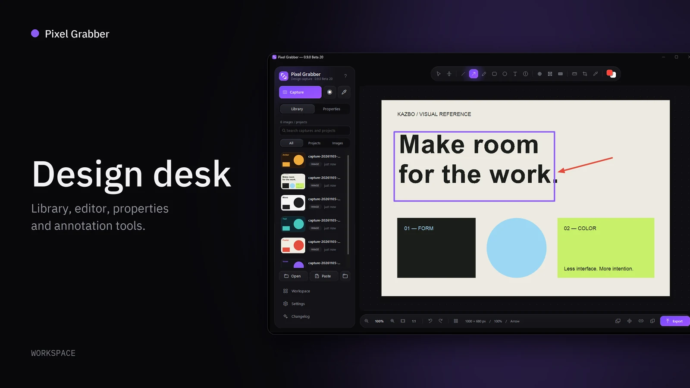</a>
 <a href="#design-desk"><strong>Design desk</strong></a>
 Workspace
</td>
<td width="50%" valign="top">
<a href="#capture">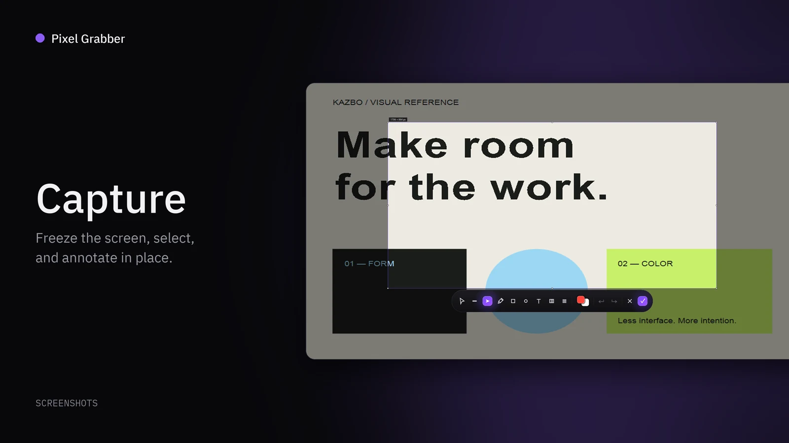</a>
 <a href="#capture"><strong>Capture</strong></a>
 Screenshots
</td>
</tr>
<tr>
<td width="50%" valign="top">
<a href="#color-tools">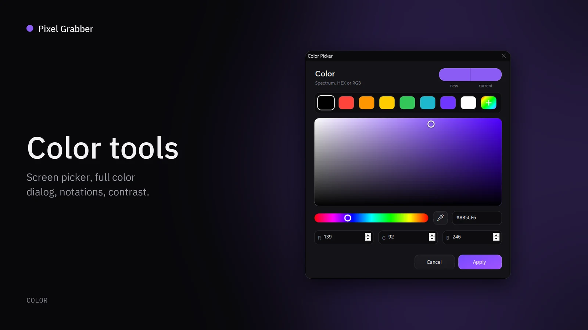</a>
 <a href="#color-tools"><strong>Color tools</strong></a>
 Color
</td>
<td width="50%" valign="top">
<a href="#workspace-menu">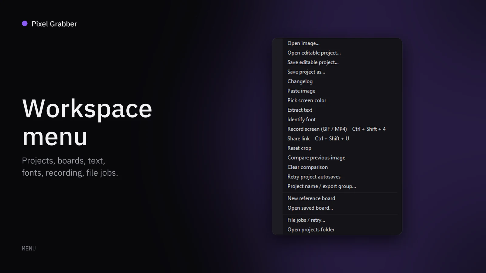</a>
 <a href="#workspace-menu"><strong>Workspace menu</strong></a>
 Menu
</td>
</tr>
<tr>
<td width="50%" valign="top">
<a href="#screen-recording">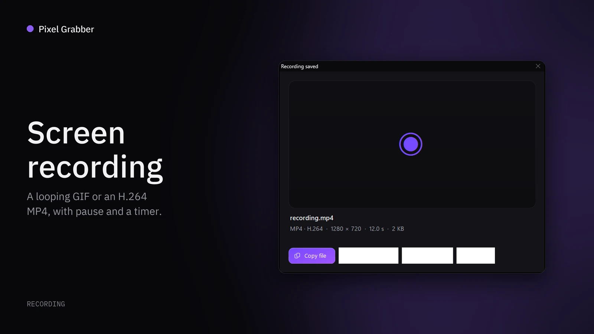</a>
 <a href="#screen-recording"><strong>Screen recording</strong></a>
 Recording
</td>
<td width="50%" valign="top">
<a href="#export">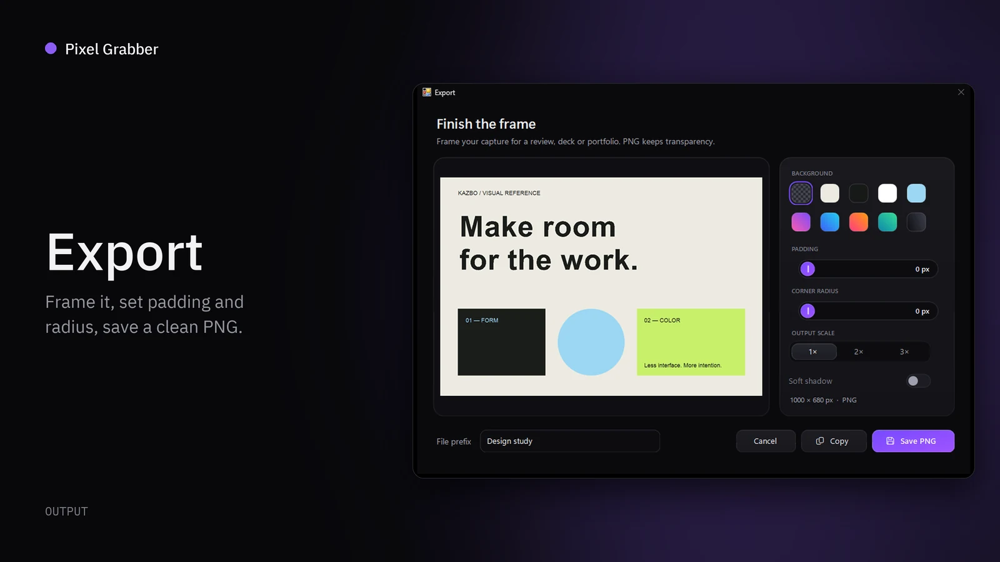</a>
 <a href="#export"><strong>Export</strong></a>
 Output
</td>
</tr>
<tr>
<td width="50%" valign="top">
<a href="#text-and-font-id">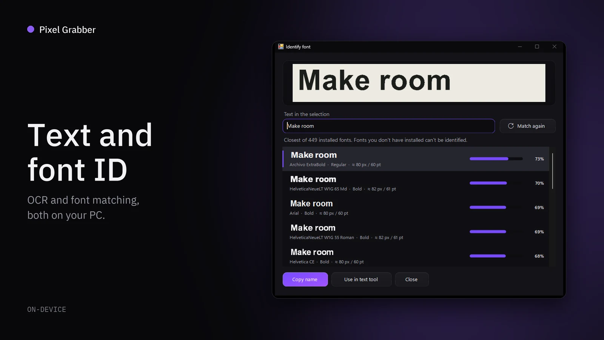</a>
 <a href="#text-and-font-id"><strong>Text and font ID</strong></a>
 On-device
</td>
<td width="50%" valign="top">
<a href="#boards-and-pins">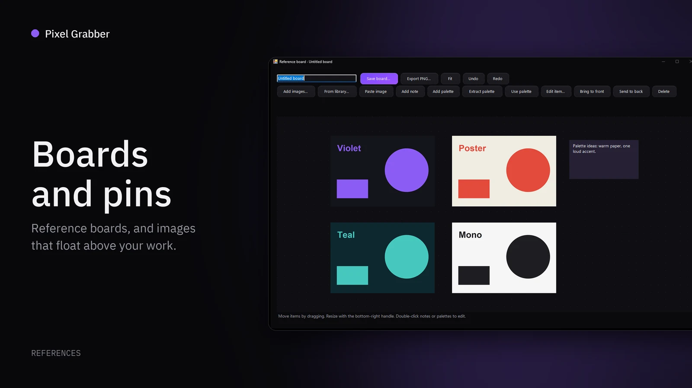</a>
 <a href="#boards-and-pins"><strong>Boards and pins</strong></a>
 References
</td>
</tr>
<tr>
<td width="50%" valign="top">
<a href="#share-links">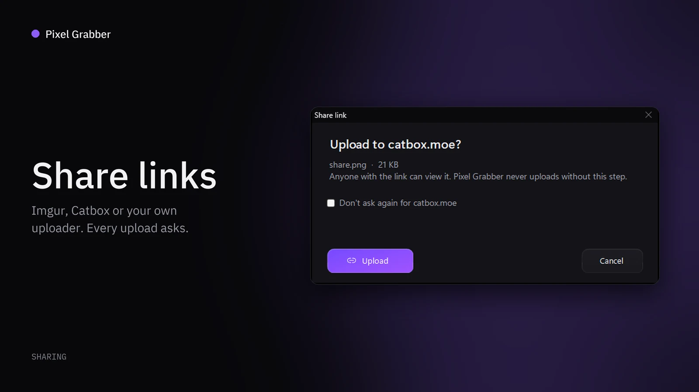</a>
 <a href="#share-links"><strong>Share links</strong></a>
 Sharing
</td>
<td width="50%" valign="top">
<a href="#settings">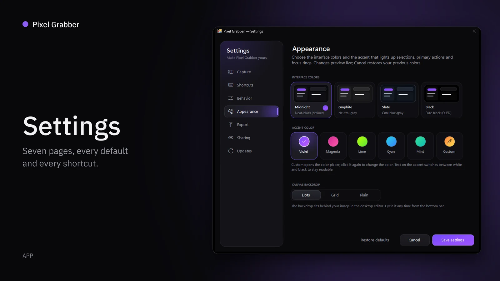</a>
 <a href="#settings"><strong>Settings</strong></a>
 App
</td>
</tr>
<tr>
<td width="50%" valign="top">
<a href="#shortcuts-and-changelog">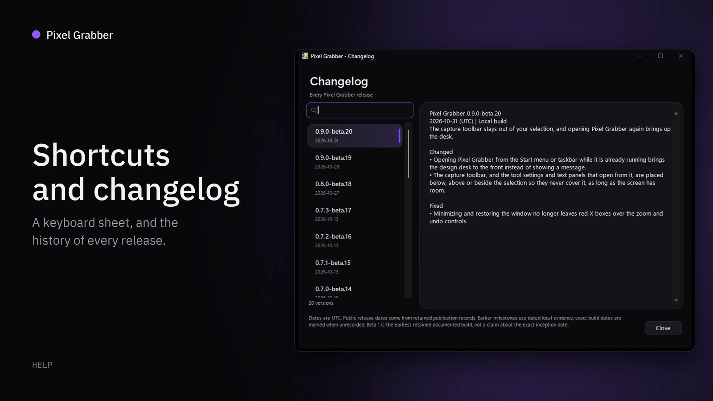</a>
 <a href="#shortcuts-and-changelog"><strong>Shortcuts and changelog</strong></a>
 Help
</td>
</tr>
</table>

**[Download the installer](https://github.com/KazboXIII/PixelGrabber/releases/download/v0.9.0-beta.20/PixelGrabber-0.9.0-beta.20-Setup-x64.exe)** · [Portable ZIP](https://github.com/KazboXIII/PixelGrabber/releases/download/v0.9.0-beta.20/PixelGrabber-0.9.0-beta.20-Portable-x64.zip) · [All releases](https://github.com/KazboXIII/PixelGrabber/releases)

---

## Table of contents

| Make | Finish | Get it |
|---|---|---|
| [Design desk](#design-desk) [Capture](#capture) [Color tools](#color-tools) [Workspace menu](#workspace-menu) [Screen recording](#screen-recording) [Export](#export) | [Text and font ID](#text-and-font-id) [Boards and pins](#boards-and-pins) [Share links](#share-links) [Settings](#settings) [Shortcuts and changelog](#shortcuts-and-changelog) | [Install](#install) [Shortcuts](#keyboard-shortcuts) [What's in Beta 20](#whats-in-beta-20) [Requirements and updates](#requirements-and-updates) [Privacy and limits](#privacy-and-limits) |

---

## What's in it

The sample images in these screenshots are built into the app or made for this page.

### Design desk

**Category:** Workspace  
**Best for:** Marking up images and keeping every capture in one place.

The main window. The library sits on the left, the image in the middle, and the annotation tools float above it. **Properties** swaps the library for image details and colors.

Highlights:

- Tools for select, pan, line, arrow, pen, rectangle, ellipse, text, step numbers, blur, mosaic, cover, ruler, crop and color pick.
- Type directly on the image and recolor it while typing.
- Edits save as editable projects you can reopen.
- Search the library, and filter by projects or images.

<table>
<tr>
<td align="center" width="25%" valign="top"><a href="./assets/readme/shots/desk-home.webp">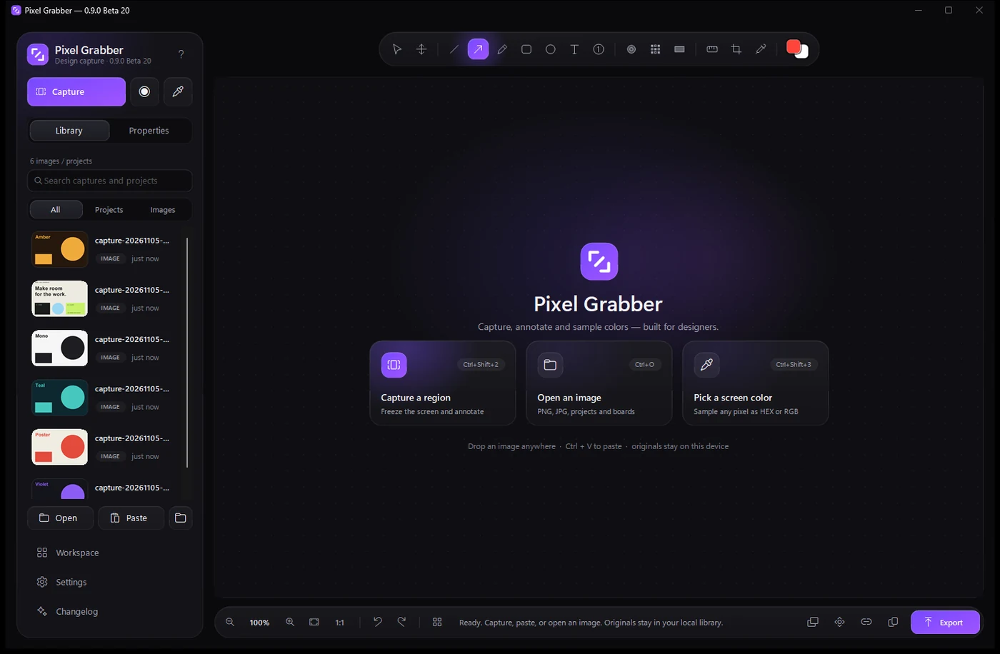</a> <code>home</code> ready to capture</td>
<td align="center" width="25%" valign="top"><a href="./assets/readme/shots/desk-editor.webp">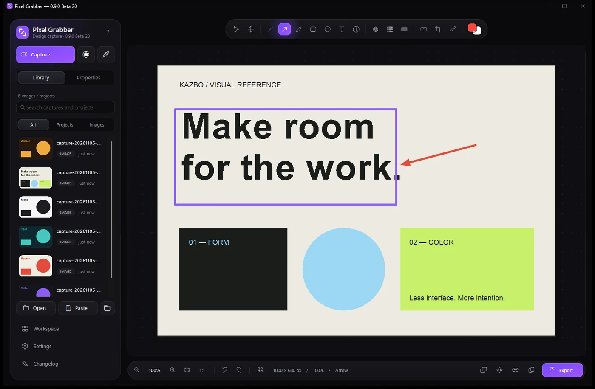</a> <code>editor</code> an annotated image</td>
<td align="center" width="25%" valign="top"><a href="./assets/readme/shots/desk-properties.webp">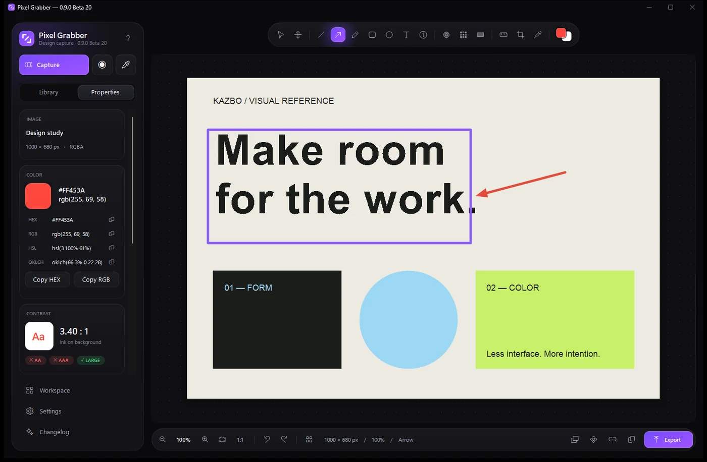</a> <code>properties</code> color and contrast</td>
<td align="center" width="25%" valign="top"><a href="./assets/readme/shots/tools.webp">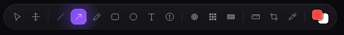</a> <code>tools</code> the annotation toolbar</td>
</tr>
</table>

---

### Capture

**Category:** Screenshots  
**Best for:** Grabbing part of the screen and annotating it right there.

**Ctrl+Shift+2** freezes the screen. Drag a selection, and a floating toolbar appears below, above or beside it so it stays out of your shot.

Highlights:

- A pixel magnifier and live dimensions while you select.
- Adjustable delay, dimming and toolbar size.
- Finish to the clipboard, a pin, a file or the editor.

<table>
<tr>
<td align="center" width="25%" valign="top"><a href="./assets/readme/shots/capture-overlay.webp">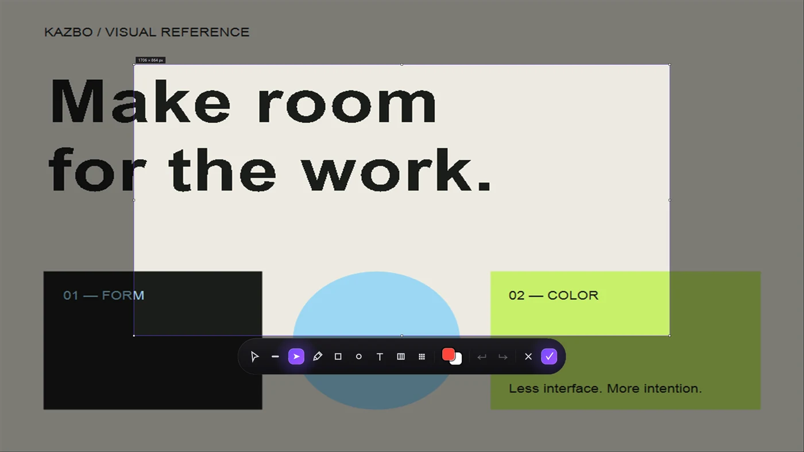</a> <code>capture</code> selection and floating toolbar</td>
</tr>
</table>

---

### Color tools

**Category:** Color  
**Best for:** Sampling colors from anywhere and checking contrast.

**Ctrl+Shift+3** samples any pixel on screen. The picker takes a spectrum, HEX or RGB, and the desk gives you color notations and a contrast check.

Highlights:

- Save swatches, extract a palette, or copy a palette as CSS.
- Copy a color as HEX or RGB.
- A contrast ratio with a pass or fail readout.

<table>
<tr>
<td align="center" width="25%" valign="top"><a href="./assets/readme/shots/color-overlay.webp">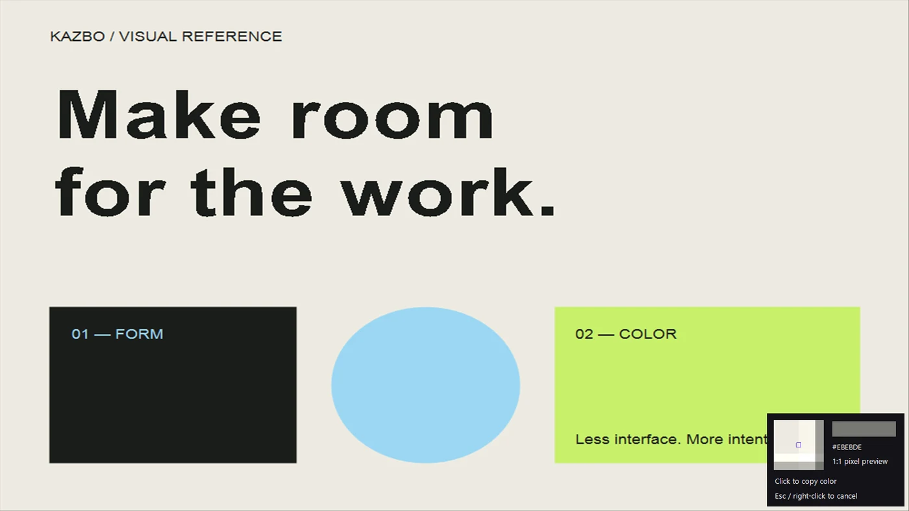</a> <code>screen picker</code> sampling a pixel</td>
<td align="center" width="25%" valign="top"><a href="./assets/readme/shots/color-picker.webp">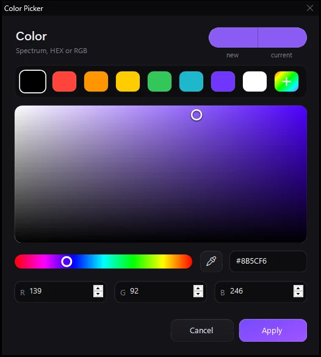</a> <code>color picker</code> spectrum, HEX and RGB</td>
</tr>
</table>

---

### Workspace menu

**Category:** Menu  
**Best for:** Everything beyond capture and annotate.

The **Workspace** item in the sidebar opens projects, boards, comparison and file jobs. The tray icon has its own menu for capture, recording, settings and updates.

Highlights:

- Open and save images and editable projects.
- Extract text, identify a font, record the screen, share a link.
- Compare with a previous image, and reset a crop.
- New and saved reference boards.
- File jobs, to retry anything that failed to save.

<table>
<tr>
<td align="center" width="25%" valign="top"><a href="./assets/readme/shots/menu-workspace.webp">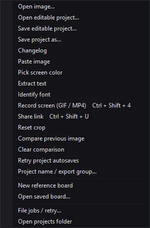</a> <code>workspace</code> the full menu</td>
<td align="center" width="25%" valign="top"><a href="./assets/readme/shots/menu-tray.webp">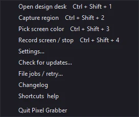</a> <code>tray menu</code> from the notification area</td>
</tr>
</table>

---

### Screen recording

**Category:** Recording  
**Best for:** Short demos and looping clips.

**Ctrl+Shift+4** records to a looping GIF or an H.264 MP4, with pause, a timer and an optional pointer. When you stop, you can copy the file, show it in its folder or share a link.

Highlights:

- GIFs stop at 60 seconds, MP4s at 30 minutes.
- Files land in `Pictures\Pixel Grabber\Recordings`, or inside your export folder.

<table>
<tr>
<td align="center" width="25%" valign="top"><a href="./assets/readme/shots/record-bar.webp">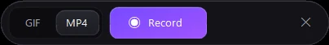</a> <code>recording bar</code> pick a format, then record</td>
<td align="center" width="25%" valign="top"><a href="./assets/readme/shots/record-result.webp">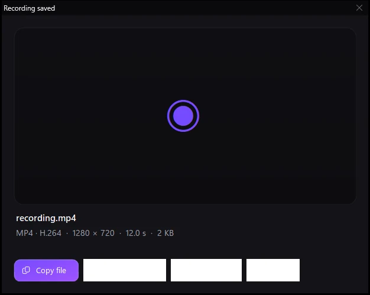</a> <code>recording saved</code> sample file shown</td>
</tr>
</table>

---

### Export

**Category:** Output  
**Best for:** Finished images for a review, a deck or a portfolio.

Frame the capture with a background, padding, corner radius and shadow, then save a PNG at 1x, 2x or 3x. Automatic exports can name files from a template.

Highlights:

- Transparent, solid or gradient backgrounds.
- Filename templates with project, date, time and sequence.

<table>
<tr>
<td align="center" width="25%" valign="top"><a href="./assets/readme/shots/export.webp">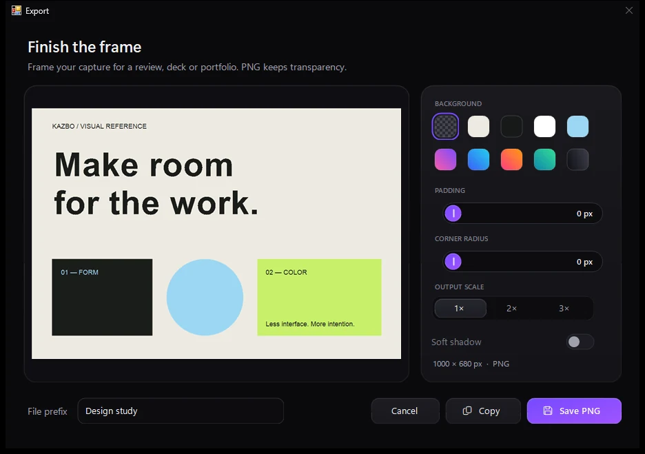</a> <code>export</code> finish the frame</td>
</tr>
</table>

---

### Text and font ID

**Category:** On-device  
**Best for:** Pulling text out of an image, and finding what font it uses.

**Extract text** uses Windows OCR. **Identify font** ranks the closest fonts installed on your PC, with an estimated size. Both run on your PC.

Highlights:

- Pick an OCR language, join wrapped lines, and copy.
- Copy the font name, or use it in the text tool.

<table>
<tr>
<td align="center" width="25%" valign="top"><a href="./assets/readme/shots/ocr.webp">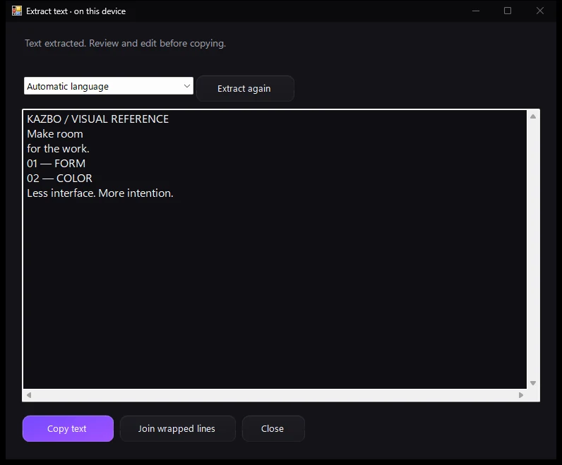</a> <code>extract text</code> on this device</td>
<td align="center" width="25%" valign="top"><a href="./assets/readme/shots/font-match.webp">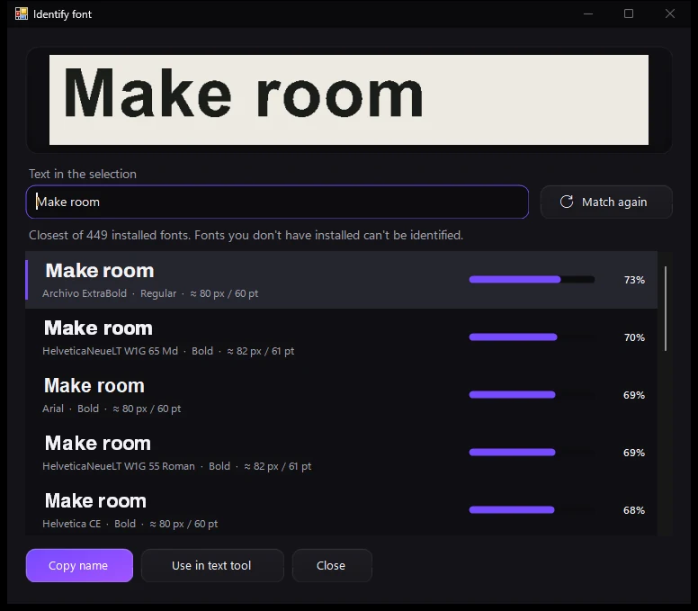</a> <code>identify font</code> ranked matches</td>
</tr>
</table>

---

### Boards and pins

**Category:** References  
**Best for:** Collecting references and keeping them on screen while you work.

A board holds images, notes and palettes on one canvas. **Pin** floats any image above other windows.

Highlights:

- Add from files, the library or the clipboard.
- Extract a palette from a board.
- Save boards and export them as a PNG.

<table>
<tr>
<td align="center" width="25%" valign="top"><a href="./assets/readme/shots/board.webp">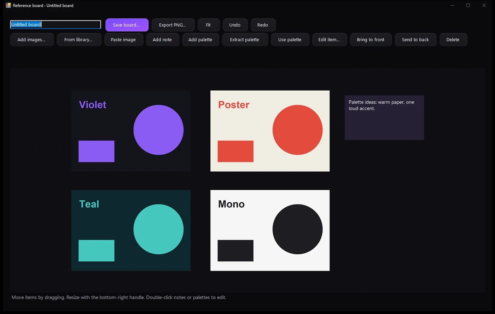</a> <code>board</code> sample images</td>
<td align="center" width="25%" valign="top"><a href="./assets/readme/shots/pin.webp">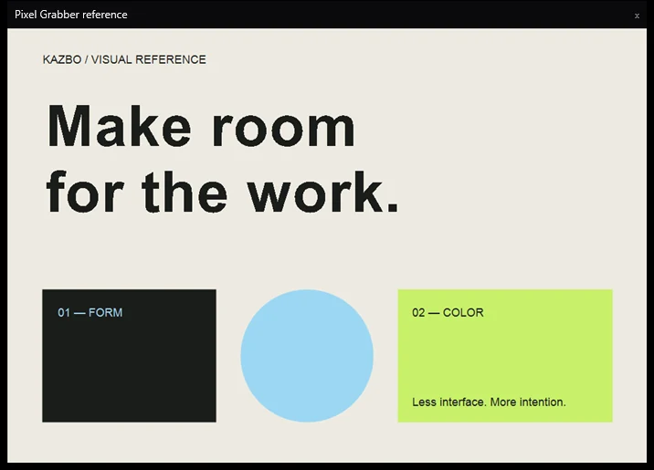</a> <code>pin</code> a floating reference</td>
</tr>
</table>

---

### Share links

**Category:** Sharing  
**Best for:** Sending a capture to someone as a URL.

Upload to Imgur, Catbox or your own uploader, and the link is copied for you. Sharing is off by default, and every upload asks first unless you turn that off.

Highlights:

- Each service is set up in **Settings > Sharing**.
- **Ctrl+Shift+U** shares the current image.

<table>
<tr>
<td align="center" width="25%" valign="top"><a href="./assets/readme/shots/share.webp">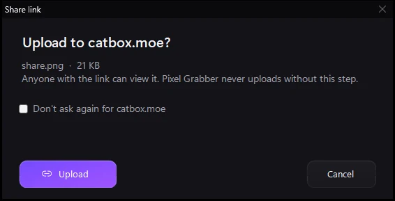</a> <code>share</code> the upload prompt</td>
<td align="center" width="25%" valign="top"><a href="./assets/readme/shots/settings-sharing.webp">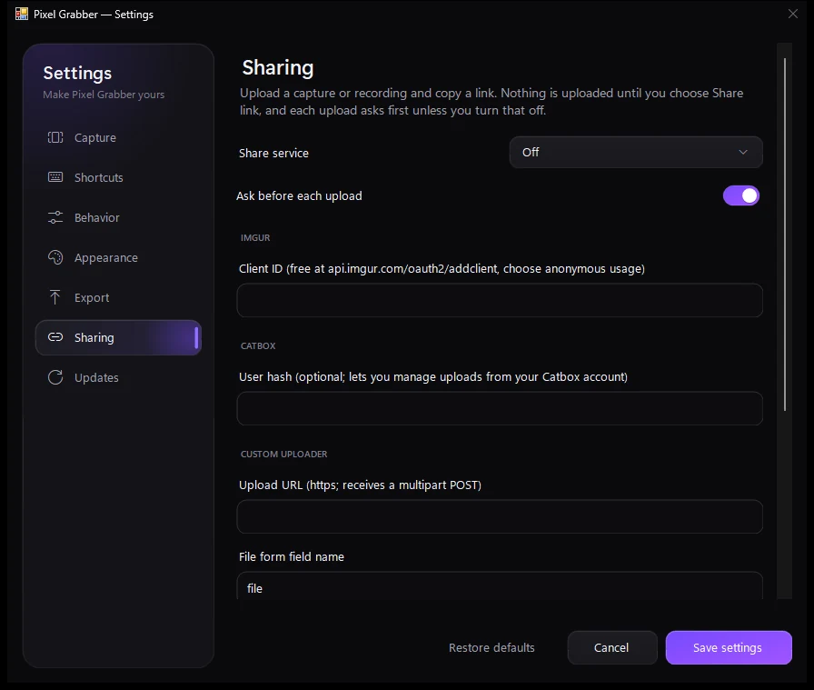</a> <code>sharing</code> services</td>
</tr>
</table>

---

### Settings

**Category:** App  
**Best for:** Making it yours.

Seven pages, opened with **Ctrl+,** or from the tray. Everything previews live, and **Cancel** restores your previous look.

Highlights:

- **Appearance:** Midnight, Graphite, Slate or Black, plus five accents or any custom color.
- **Capture**, **Behavior** and **Export** defaults.
- Every shortcut can be changed.
- **Updates:** automatic checks and beta releases.

<table>
<tr>
<td align="center" width="25%" valign="top"><a href="./assets/readme/shots/settings-capture.webp">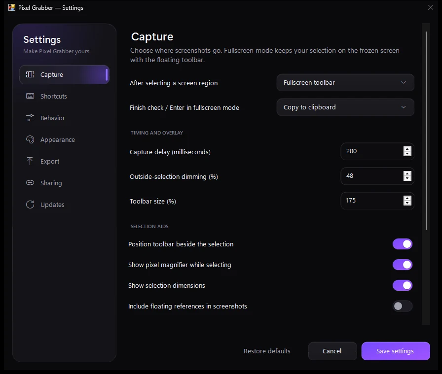</a> <code>capture</code> selection aids</td>
<td align="center" width="25%" valign="top"><a href="./assets/readme/shots/settings-shortcuts.webp">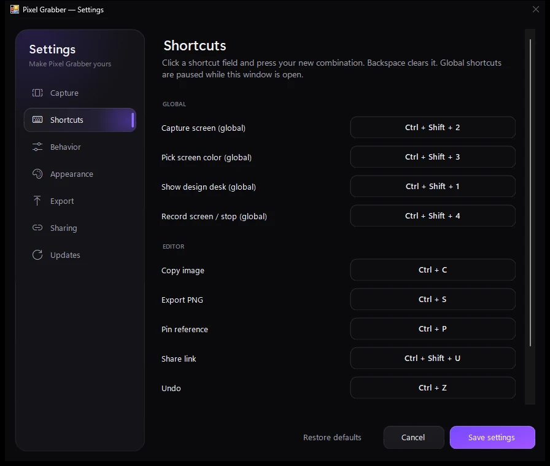</a> <code>shortcuts</code> global and editor</td>
<td align="center" width="25%" valign="top"><a href="./assets/readme/shots/settings-behavior.webp">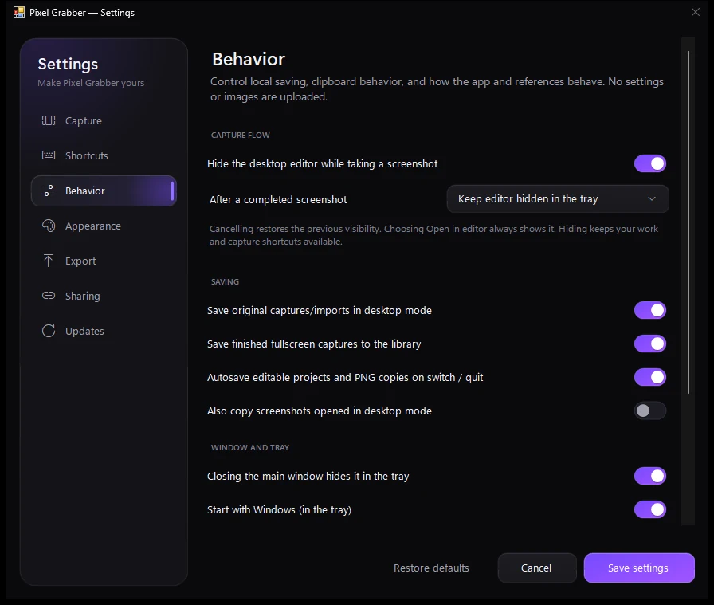</a> <code>behavior</code> saving and the tray</td>
<td align="center" width="25%" valign="top"><a href="./assets/readme/shots/settings-appearance.webp">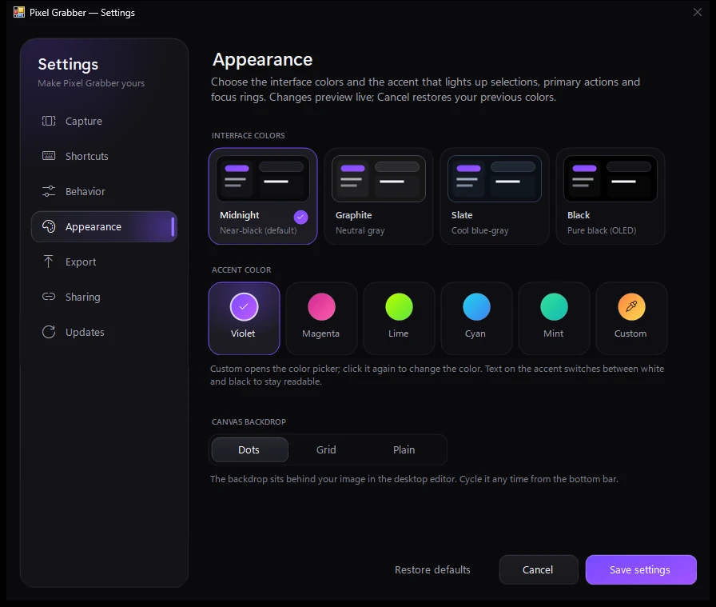</a> <code>appearance</code> colors and backdrop</td>
</tr>
<tr>
<td align="center" width="25%" valign="top"><a href="./assets/readme/shots/settings-export.webp">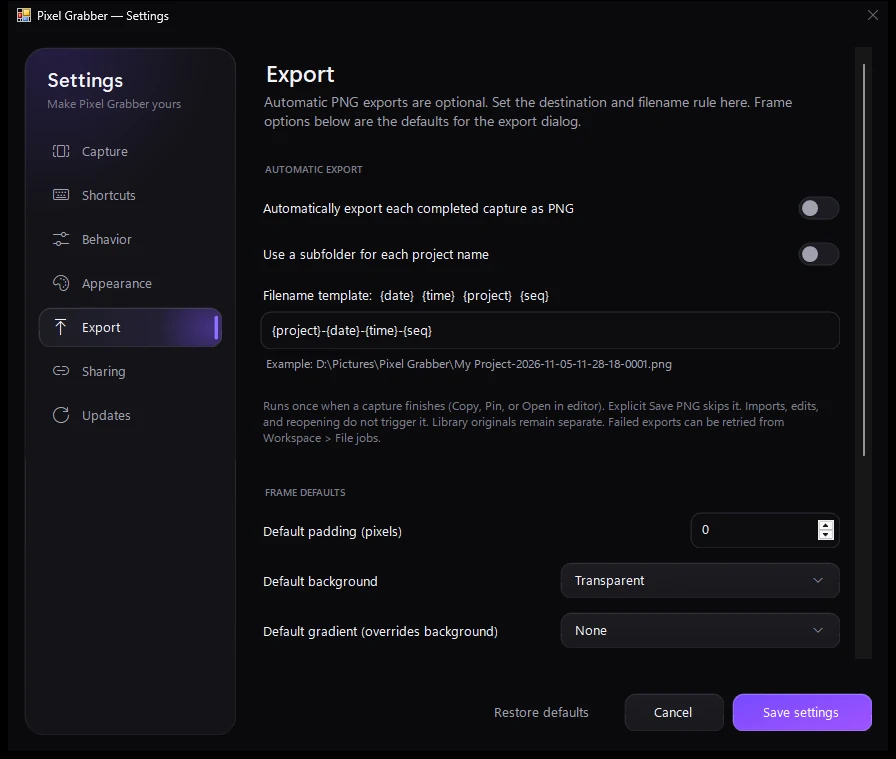</a> <code>export</code> templates and frames</td>
<td align="center" width="25%" valign="top"> <code>sharing</code> services</td>
<td align="center" width="25%" valign="top"><a href="./assets/readme/shots/settings-updates.webp">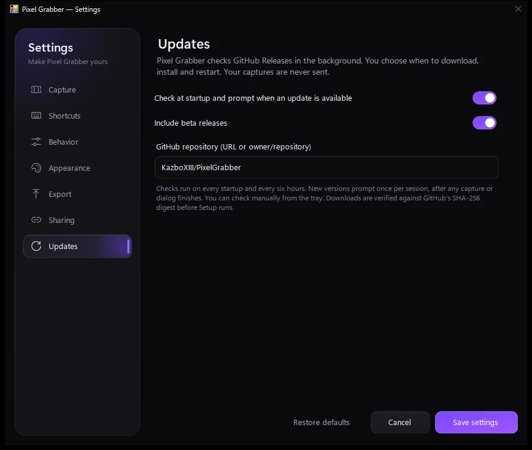</a> <code>updates</code> checks and betas</td>
</tr>
</table>

---

### Shortcuts and changelog

**Category:** Help  
**Best for:** Learning the keys and seeing what changed.

A one-page sheet of every shortcut, and a searchable history of every release.

<table>
<tr>
<td align="center" width="25%" valign="top"><a href="./assets/readme/shots/shortcuts.webp">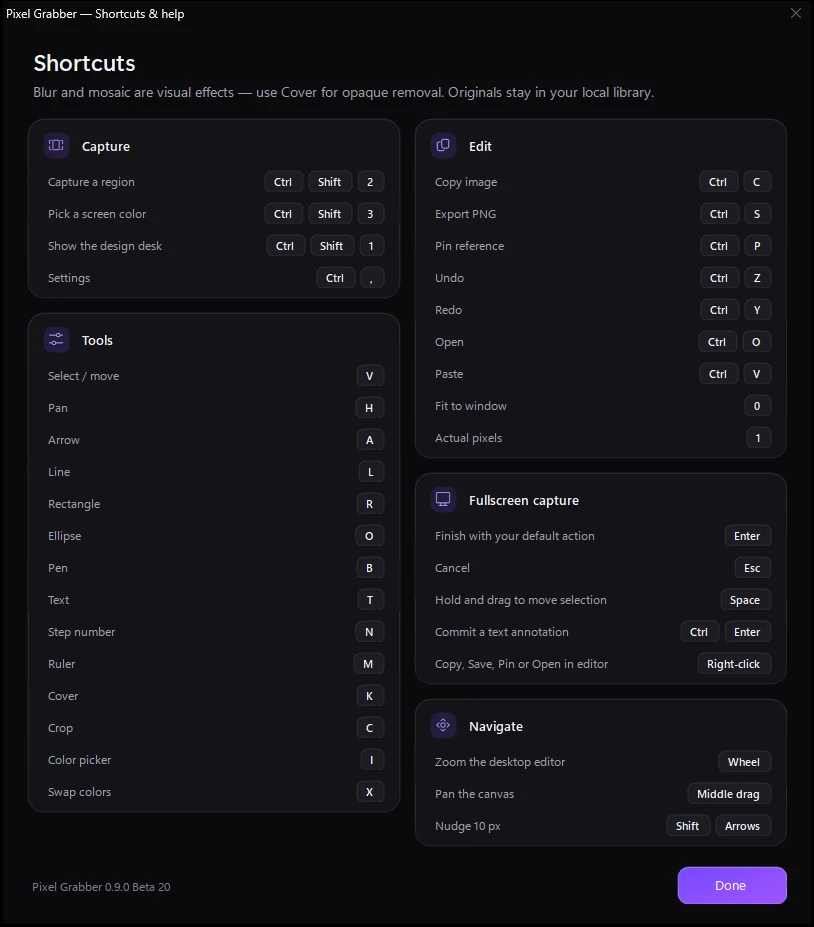</a> <code>shortcuts</code> the full sheet</td>
<td align="center" width="25%" valign="top"><a href="./assets/readme/shots/changelog.webp">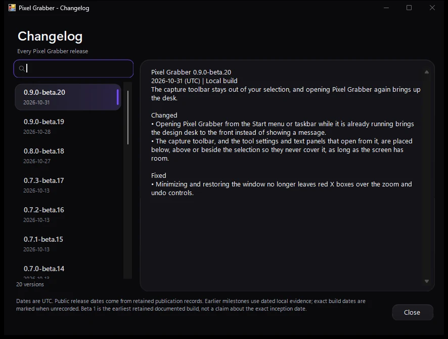</a> <code>changelog</code> every release</td>
</tr>
</table>

---

## Install

| Download | Best for | Updates |
|---|---|---|
| [Windows x64 installer](https://github.com/KazboXIII/PixelGrabber/releases/download/v0.9.0-beta.20/PixelGrabber-0.9.0-beta.20-Setup-x64.exe) | Most people | Built in |
| [Portable Windows x64 ZIP](https://github.com/KazboXIII/PixelGrabber/releases/download/v0.9.0-beta.20/PixelGrabber-0.9.0-beta.20-Portable-x64.zip) | Running without installing. Extract and run PixelGrabber.exe. | Replace it by hand |

Also in this release: [feature guide](https://github.com/KazboXIII/PixelGrabber/releases/download/v0.9.0-beta.20/FEATURE-GUIDE.txt), [beta notes](https://github.com/KazboXIII/PixelGrabber/releases/download/v0.9.0-beta.20/BETA-NOTES.txt), [tester guide](https://github.com/KazboXIII/PixelGrabber/releases/download/v0.9.0-beta.20/TESTER-GUIDE.txt) and [SHA-256 checksums](https://github.com/KazboXIII/PixelGrabber/releases/download/v0.9.0-beta.20/SHA256SUMS.txt).

## Keyboard shortcuts

| Keys | What it does |
|---|---|
| **Ctrl+Shift+2** | Capture a region and annotate it on screen |
| **Ctrl+Shift+3** | Pick a screen color |
| **Ctrl+Shift+4** | Record the screen |
| **Ctrl+Shift+1** | Open the design desk |
| **Ctrl+,** or the tray menu | Settings and customizable shortcuts |

## What's in Beta 20

- **The capture toolbar stays out of your shot**: it sits below, above or beside the selection instead of covering it.
- **Open it again to bring up the desk** when Pixel Grabber is already running.
- **Fixed** red X boxes over the zoom controls after minimizing the window.

Beta 19 added:

- **Screen recording** to a looping GIF or an H.264 MP4, with pause, a timer and an optional pointer.
- **Share links** to Imgur, Catbox or your own uploader. Off by default; every upload asks first.
- **Identify font**: rank the closest fonts installed on your PC for text in an image.
- **Interface colors**: Midnight, Graphite, Slate or Black, plus any custom accent color.
- **Text in place**: type directly on the image and recolor it while typing.

Earlier betas added editable projects, on-device text extraction (Windows OCR), reference boards, automatic exports, color notations with a contrast check, and framed exports.

## Requirements and updates

| Needs | Details |
|---|---|
| Windows | Windows 10 version 1809 or newer, or Windows 11. ARM Windows is unsupported. |
| Processor | Intel or AMD x64 |
| Runtime | .NET Framework 4.8 |
| Text extraction and font ID | Installed Windows OCR language support |

The app and installer are unsigned.

Close Pixel Grabber before installing. Upgrades keep your library, settings, startup choice and install folder; data lives in `%LOCALAPPDATA%\PixelGrabber`. Installed copies check this page's releases and let you choose when to install. Settings > Updates controls automatic checks and beta releases. Downloads are checked against GitHub's SHA-256 asset digest. Portable copies need manual replacement.

## Privacy and limits

Text extraction and font identification run on your PC. Nothing is uploaded unless you set up and confirm a share link, and there is no telemetry.

**Editable projects keep the original pixels underneath redactions and outside crops.** For redacted delivery, use a flattened PNG, Copy or Drag image with opaque Cover annotations. Blur and mosaic are visual effects, not secure redaction.

This repository distributes releases and product documentation. Older releases remain available.
